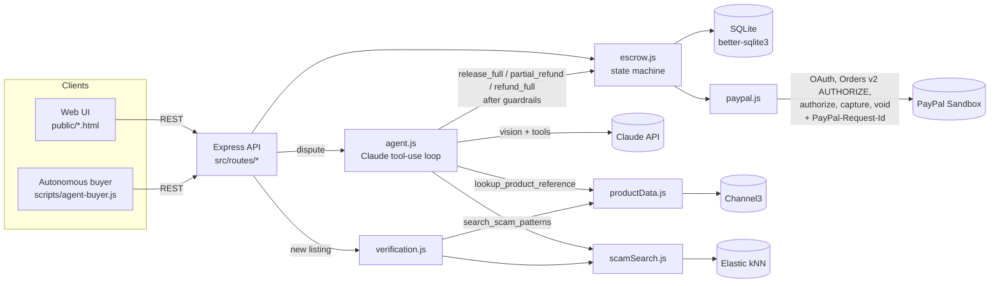

# Funguo — AI-adjudicated escrow on PayPal

*Funguo* is Swahili for "key".

Paying a stranger online is a trust problem, and AI shopping agents that buy on someone's behalf make it worse: the buyer pays up front and has little recourse if the item is wrong. Funguo is an escrow service built on PayPal's **authorize / capture / void** model. The buyer, whether a person or an autonomous agent, pays into a PayPal **authorization hold** instead of paying the seller. The funds are captured to the seller only when the item is confirmed as described. If there's a dispute, a **Claude-powered adjudication agent** gathers evidence: the listing, the buyer's photo, tracking, seller history, market prices and known scam patterns. It then decides and executes the matching PayPal call itself: full capture, a partial capture (which partially refunds the buyer), or a void. Every decision comes with a written rationale, and code-level guardrails escalate to a human when the agent isn't sure.

**Hosted demo:** _TBD — see [Deploying to Render](#deploying-to-render)_

---

## Run it locally

Requirements: Node.js 20+ (tested on 22).

```bash
git clone <this repo> funguo && cd funguo
npm install
cp .env.example .env        # then fill in the keys below
npm run seed                # demo sellers, listings, scam-pattern index
npm run dev                 # http://localhost:3000
```

### Keys

| Variable | Where to get it | Required? |
|---|---|---|
| `PAYPAL_CLIENT_ID`, `PAYPAL_SECRET` | [developer.paypal.com](https://developer.paypal.com/dashboard/applications/sandbox) → Apps & Credentials → **Sandbox** → Create App | **Yes** (or set `PAYPAL_MODE=simulate`, see below) |
| `ANTHROPIC_API_KEY` | [console.anthropic.com](https://console.anthropic.com/) → API Keys | Recommended. Without it, disputes use a clearly-labelled rule-based fallback |
| `CHANNEL3_API_KEY` | [trychannel3.com](https://trychannel3.com) (free tier) | Optional. Seeded reference prices are used without it |
| `ELASTIC_URL`, `ELASTIC_API_KEY` | Elastic Cloud deployment → endpoint + API key | Optional. A local cosine search is used without it (run `npm run seed` after setting these to build the index) |

The server **refuses to start** without PayPal sandbox credentials and tells you what to fix. To click through without any keys, set `PAYPAL_MODE=simulate`: an in-process PayPal stand-in answers the same five endpoints, and a yellow banner on every page says so.

PayPal sandbox buyer login: in the developer dashboard go to **Testing Tools → Sandbox Accounts**. A *Personal* account is created for you. Use its email and password (shown via "View/Edit account") when PayPal asks you to log in during checkout.

Sanity-check your PayPal credentials with `npm run test:paypal`. It runs OAuth, creates an order, does a partial capture, checks that a retried capture is deduplicated, voids a second order, and prints the ids.

### Click-through: happy path

1. Open http://localhost:3000. The seller dashboard shows the seeded listings with their verification results. Create your own listing to get a shareable checkout link.
2. Open **Sony WH-1000XM5** → **Pay with PayPal**. Funguo creates an Orders v2 order with `intent: AUTHORIZE` and redirects you to PayPal. Log in with the sandbox *personal* account and approve.
3. PayPal returns you to the order page. Funguo calls `/authorize`, and the order is **HELD**. The **PayPal order id** and **authorization id** appear on the right, and you can find both in the sandbox dashboard (log in to sandbox.paypal.com as the sandbox *business* account → Activity).
4. **Mark shipped** (seller) → **Mark delivered** (carrier) → **Confirm receipt & release**. Funguo calls `/v2/payments/authorizations/{id}/capture` and the order is **RELEASED**, with the capture id shown.

(No PayPal login handy? **Use sandbox test card instead** places the hold with no redirect.)

### Click-through: dispute path

1. Buy the Sony headphones again and take the order to **INSPECTED** (or dispute straight from HELD/SHIPPED).
2. **Something's wrong — open a dispute**. Paste a complaint and upload [`scripts/fixtures/wrong-item.png`](scripts/fixtures/wrong-item.png), which shows generic "SONNY" earbuds instead of over-ear headphones. Submit.
3. The order goes to **DISPUTED** (funds stay held) and the agent runs, usually in 20–60 s. The card then shows the **decision**, **confidence**, the written **rationale**, the evidence weighed, the **PayPal response**, and the full agent transcript, including Claude's summarized reasoning and every tool call.
4. Expected: **Full refund**. The authorization is voided, the buyer is never charged, and the order is **RESOLVED_REFUND**.
5. Try [`scripts/fixtures/scuffed-item.png`](scripts/fixtures/scuffed-item.png) with "deep scratches, listing said like new". Expect a **partial refund**: Funguo captures `price − refund` with `final_capture: true`, PayPal releases the rest of the hold, and the order is **RESOLVED_PARTIAL**.
6. If the agent escalates, a **Human reviewer decision** panel appears on the order page.

### Agent-native: drive it with no UI

```bash
npm run agent-buyer                                  # dispute scenario against localhost:3000
npm run agent-buyer -- --scenario happy
npm run agent-buyer -- --base https://<your-render-url> --method paypal   # hands the approval link to a human
```

[`scripts/agent-buyer.js`](scripts/agent-buyer.js) is an autonomous buyer that uses only the REST API. It screens listings (and skips the high-risk iPhone), pays into escrow with a sandbox card, tracks shipping, files a dispute with a photo, and polls until the adjudicator has decided.

---

## Agent API

Plain JSON over HTTP. No auth in the demo; see the stubbed table below.

| Method & path | What it does |
|---|---|
| `GET /api/health` | Modes in use (PayPal, agent engine, product data, scam search) |
| `GET /api/listings` · `GET /api/listings/:id` | Listings with `verification` (risk, flags, market reference) and `checkout_url` |
| `POST /api/listings` | `{seller_id, title, description, price, image_url?}`. Runs listing verification and returns the listing + checkout link |
| `POST /api/orders` | `{listing_id, buyer_name?, buyer_email?, buyer_kind: "agent"\|"human", payment_method: "card"\|"paypal"}`. `card` → hold placed immediately (`HELD`); `paypal` → `order.approval_url` for a human to approve |
| `GET /api/orders/:id` | Order + state, `allowed_actions`, event history, every PayPal call (with `PayPal-Request-Id`), disputes |
| `POST /api/orders/:id/authorize` | Place the hold after out-of-band approval |
| `POST /api/orders/:id/ship` | `{carrier, tracking_number}` → `SHIPPED` |
| `POST /api/orders/:id/deliver` | Carrier delivered → `INSPECTED` |
| `POST /api/orders/:id/confirm` | Capture in full → `RELEASED` |
| `POST /api/orders/:id/disputes` | multipart: `complaint` + optional `photo` (JPEG/PNG/WebP/GIF ≤5 MB) → `DISPUTED`; agent runs in background (`?wait=1` to block) |
| `GET /api/disputes/:id` | Status, decision, refund amount, confidence, rationale, findings, transcript, PayPal response |
| `POST /api/disputes/:id/resolve` | Human reviewer: `{decision: release_full\|partial_refund\|refund_full, refund_amount?, note?}` (escalated disputes only) |
| `POST /api/disputes/:id/retry` | Re-run the agent on an escalated dispute |
| `POST /api/webhooks/paypal` | PayPal webhook receiver (signature-verified when `PAYPAL_WEBHOOK_ID` is set) |

## Order state machine

```
INITIATED → HELD → SHIPPED → INSPECTED → RELEASED
              ╲        ╲          ╲
               └────────┴──────────┴──→ DISPUTED → RESOLVED_RELEASE   (capture full)
                                                → RESOLVED_PARTIAL   (capture less, final_capture)
                                                → RESOLVED_REFUND    (void)
```

Every transition is written to `order_events` with a timestamp, the actor (buyer / seller / carrier / agent / human-reviewer) and a note, in the same SQLite transaction as the state change. Illegal transitions return `409`. Money-moving operations are serialized per order.

## Architecture



### The dispute agent ([`src/agent.js`](src/agent.js))

- **Case file**: listing (title, description, price, image), listing-verification result, order and authorization details, delivery/tracking status and timestamps, seller history (orders, disputes, dispute rate, verification flag), the buyer's complaint, and the buyer's **photo as an image input**. Claude looks at it directly.
- **Evidence tools**: `lookup_product_reference` (Channel3 market prices) and `search_scam_patterns` (vector search over known fraud patterns such as "lookalike brand substitution").
- **Decision tools**: `release_full`, `partial_refund(refund_amount)`, `refund_full`, and `escalate_to_human`. Each one requires a `rationale`, a calibrated `confidence`, the `evidence` relied on, and any `conflicting_evidence`. Calling a money tool **executes the PayPal call**, and the PayPal response is returned to the model as the tool result and saved.
- **Guardrails, enforced in code rather than the prompt**. Each one turns the decision into `escalate_to_human`, and no money moves:
  - confidence below `AGENT_MIN_CONFIDENCE` (default 0.7)
  - the agent reported conflicting evidence and its confidence is below 0.85
  - `release_full` on an item with no shipment record
  - more than one decision in a single turn
  - no decision within 8 turns, a refusal, a truncated response, or any error
  - an invalid partial amount is sent back to the model to correct
- **Prompt-injection stance**: the complaint, listing text and photo are wrapped in `<case_file>` and treated as evidence, never instructions. Attempts to steer the decision are to be logged as conflicting evidence.
- **Explainability**: the rationale, evidence list, confidence, any guardrail that fired (with the model's original proposal), Claude's summarized reasoning, and the full tool-call transcript are persisted and shown on the order page.
- Model: `claude-opus-5-5` with adaptive thinking at `effort: high` and strict tool schemas. The server-side refusal fallback is enabled (`fallbacks: "default"`); if a key doesn't have that beta, the agent continues without it.
- **Honest limits**: the agent's judgement is only as good as the evidence. A doctored photo, or a seller who ships the right box with the wrong contents, can still fool it. Escalation exists for exactly those cases, and a human can always overrule.

### PayPal integration ([`src/paypal.js`](src/paypal.js))

Raw `fetch`, no SDK, sandbox base URL only.

- `POST /v1/oauth2/token` (client credentials). The token is cached and refreshed 5 minutes before expiry.
- `POST /v2/checkout/orders` with `intent: "AUTHORIZE"` and either `payment_source.paypal.experience_context` (return/cancel URLs → approval link) or `payment_source.card` (sandbox test card, authorized inline).
- `POST /v2/checkout/orders/{id}/authorize` places the hold, and Funguo stores the `authorization_id` and its expiry.
- `POST /v2/payments/authorizations/{id}/capture`: the full amount for a release, or `price − refund` with `final_capture: true` for a partial refund.
- `POST /v2/payments/authorizations/{id}/void` for a full refund before capture.
- **Idempotency**: every mutating call sends `PayPal-Request-Id`, derived deterministically from *(order, operation, amount)*, so a retried or double-clicked capture is deduplicated by PayPal instead of charging twice.
- Authorizations hold funds for up to **29 days**, with a ~**3-day honor period** (see the code comment on reauthorization).

## Tools used

| Tool | How Funguo uses it |
|---|---|
| **PayPal Orders v2** | Creates the escrow hold (`intent: AUTHORIZE`) and authorizes it after buyer approval. |
| **PayPal Payments v2** | Releases funds (capture, full or partial with `final_capture`) or refunds (void) the authorization. |
| **Claude (Anthropic API, `claude-opus-5-5`)** | Vision + tool-use dispute adjudicator whose decision tools execute the PayPal calls. |
| **Channel3** | Product search for market reference prices, used in listing verification and by the agent to value partial refunds. |
| **Elastic** | kNN vector search over a corpus of known scam-listing patterns, used in listing verification and by the agent. |
| **APIMatic** | Context Plugin for PayPal Server SDKs to keep coding agents on the current SDK surface (see below; not wired). |
| **Render** | Hosting via the `render.yaml` Blueprint. |

### APIMatic

APIMatic publishes a [Context Plugin for PayPal Server SDKs](https://developer.paypal.com/community/blog/A%20New%20Context%20Plugin%20for%20AI-Assisted%20Coding%20with%20PayPal%20SDKs) (beta). It is an MCP server that gives Claude Code, Cursor and similar tools current, accurate context for `@paypal/paypal-server-sdk`. Funguo deliberately calls PayPal over raw REST (`paypal.js` is ~150 lines), so the plugin isn't in the request path. Here is where it would fit:

1. **Building Funguo**: install the plugin in Claude Code, and when extending `paypal.js` (reauthorize, refunds after capture, Partner Referrals for the platform fee), the coding agent works from the current `OrdersController` / `PaymentsController` surface instead of deprecated v1 patterns.
2. **Swapping the client**: `paypal.js` keeps one exported function per PayPal operation, so its body could be replaced with `@paypal/paypal-server-sdk` calls generated with the plugin's help, leaving the rest of Funguo unchanged.

## What's real vs stubbed

| Area | Status |
|---|---|
| PayPal OAuth, create order (AUTHORIZE), authorize, capture, partial capture, void, idempotency keys | **Real** (sandbox) |
| PayPal buyer approval redirect + return | **Real** (sandbox) |
| `PAYPAL_MODE=simulate` | **Stand-in**, opt-in only, labelled on every page. Mirrors response shapes for keyless click-through |
| Claude dispute agent (vision, tool use, guardrails, rationale) | **Real** with `ANTHROPIC_API_KEY`; otherwise a **rule-based fallback** that says so in every rationale and never analyses the photo |
| Channel3 product data | **Real call** with `CHANNEL3_API_KEY`; otherwise a **seeded catalog** of reference prices |
| Elastic scam search | **Real kNN index** with `ELASTIC_URL`/`ELASTIC_API_KEY`; otherwise **local cosine** over the same vectors |
| Scam-pattern corpus | **Seeded**: 18 hand-written patterns, not a real fraud dataset |
| Embeddings | **Local feature-hashing embedding** (deterministic, no API). `TODO(live)`: a hosted embedding model |
| Seller ID verification (KYC) | **Mocked**: a `verified` flag on seeded sellers |
| Seller history | Seeded prior orders/disputes **plus** real orders/disputes in this database |
| Platform fee | **Computed and recorded** (`PLATFORM_FEE_BPS`), **not split**. A real split needs `payment_instruction.platform_fees` and PayPal Commerce Platform partner onboarding, which isn't available to a sandbox app in the hackathon timeframe |
| Shipping / delivery | **Simulated** buttons. `TODO(live)`: carrier tracking webhooks |
| Auth / accounts | **None**: anyone with an order link can act as buyer or seller. Fine for a demo, not for production |
| PayPal webhooks | Received, signature-verified when `PAYPAL_WEBHOOK_ID` is set, and logged. Not used to drive state |
| Authorization > 3 days (honor period) | Not handled; production would reauthorize. Demo flows finish in minutes |

## Deploying to Render

1. Push this repo to GitHub (public).
2. Render → **New → Blueprint** → select the repo. `render.yaml` defines a free Node web service.
3. Fill in the prompted secrets (`PAYPAL_CLIENT_ID`, `PAYPAL_SECRET`, `ANTHROPIC_API_KEY`, optional sponsor keys).
4. Deploy. `npm start` seeds demo data when the DB is empty, and `BASE_URL` defaults to Render's `RENDER_EXTERNAL_URL`, so PayPal return URLs work with no extra config.

On the free plan, the SQLite file resets on every deploy or spin-down, and the app re-seeds. A dispute interrupted by a restart is escalated automatically, so the agent never leaves money half-moved.

## Project layout

```
src/
  server.js          Express app, PayPal return/cancel, error handling
  config.js          env loading + loud validation
  paypal.js          PayPal REST client (OAuth, Orders v2, Payments v2)
  paypalSim.js       opt-in simulator (PAYPAL_MODE=simulate)
  escrow.js          state machine + every money-moving operation
  agent.js           Claude dispute adjudicator
  productData.js     Channel3 interface (+ seeded fallback)
  scamSearch.js      Elastic interface (+ local cosine fallback)
  embed.js           deterministic text embedding
  verification.js    listing verification
  db.js              SQLite schema + helpers
  routes/            listings, orders, disputes, webhooks
  data/              seeded scam corpus + reference catalog
public/              UI (plain HTML + Tailwind CDN)
scripts/
  seed.js            demo data + scam index
  agent-buyer.js     autonomous buyer over HTTP
  paypal-smoke.js    sandbox check for paypal.js
  fixtures/          demo dispute photos
```

## License

[MIT](LICENSE)
